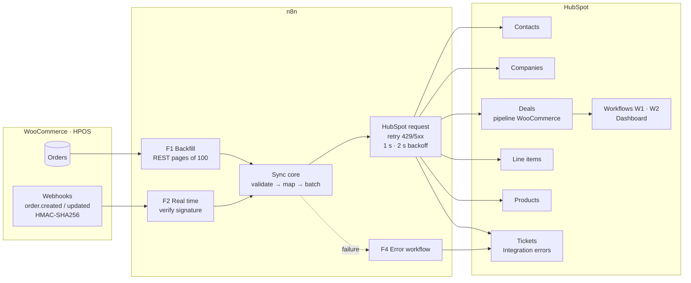

# WooCommerce → HubSpot sync (n8n)

A sync a sales team can trust: WooCommerce customers, orders and products land in HubSpot as contacts,
companies, deals and line items, **exactly once**, with refunds reflected, bad data quarantined, and
retries that never create duplicates. Built with n8n and the HubSpot CRM API; runs locally with one
`docker compose up`.

> Demo project. All data is generated (seed 42): fictional names, company domains on the reserved
> `.test` TLD, no real customers. HubSpot side runs in a free developer test account.

<!-- Screenshots go here (docs/screenshots): pipeline, contact timeline, dashboard, n8n execution -->

## Why not the official app?

The free "HubSpot for WooCommerce" plugin covers the basics. This project targets what it does not do,
or charges for:

| Real problem | Native app | This sync |
|---|---|---|
| Modern Woo stores use **HPOS** order tables | Paid add-on | Reads orders through the Woo REST API → HPOS-independent |
| HubSpot does **not dedupe companies created via API** | — | Searches by domain before creating |
| Retries that **duplicate deals** | Not documented | Upserts by unique `woo_order_id` (idempotent) |
| **Refunds and cancellations** | Not documented | Deal stage and amount follow the refund |
| **Dirty data** (typo emails, phones, countries) | No | Validation + "Needs review" list + error tickets |
| Own business rules (repeat buyer, VIP) | Limited | HubSpot workflows on synced totals |

## How it works



Per batch of ≤100 orders the sync core writes, in order: contacts (upsert by email, with order totals) →
companies (search by domain, create only the missing ones) → products → deals → line items →
associations → error tickets. About 10 HubSpot requests per 100 orders, far under the 100 requests / 10 s limit.

## Data mapping

| WooCommerce | HubSpot | Idempotency key |
|---|---|---|
| Billing customer | Contact | `email` |
| Billing company / email domain (not gmail, hotmail…) | Company | `domain` (searched first) |
| Product | Product | `woo_product_id` (searched first — HubSpot products can't have unique properties) |
| Order | Deal in pipeline **WooCommerce** | `woo_order_id` (unique) |
| Order item | Line item (linked to product and deal) | `woo_line_item_id` (searched first) |
| Sync problem | Ticket in pipeline **Integration errors** | `sync_error_key` (unique) |

| Woo status | Deal stage |
|---|---|
| pending, on-hold | Pending payment |
| processing | Paid |
| completed | Closed won (amount net of partial refunds) |
| cancelled, failed | Closed lost |
| refunded | Refunded (amount 0, `refund_amount` = refunded total) |

Contact properties written by the sync: `total_orders`, `woo_total_revenue` (paid orders, net of refunds; HubSpot's own `total_revenue` is read-only),
`first_order_date`, `last_order_date`, `woo_customer_id`, `data_quality_status`, `data_quality_issues`.
`customer_segment` (new / repeat / VIP) is set by HubSpot workflow W1 — see
[docs/hubspot-config.md](docs/hubspot-config.md) for W1, W2, the list and the dashboard.

## Decisions

| Decision | Why |
|---|---|
| All HubSpot calls via HTTP Request + batch endpoints, not n8n's HubSpot node | The node has no line items, products or associations, and works one record at a time |
| Totals computed from Woo, not HubSpot rollups | Woo is the source of truth for refunds; rollup support varies by tier |
| One "HubSpot request" sub-workflow for every call | One place for auth, retries and backoff (429 waits out the 10 s window, 423 ≥ 2 s, honors `Retry-After`) |
| A rejected batch (4xx) becomes a ticket, not a crash | HubSpot rejects the whole batch for one bad record; the other objects of the chunk still sync |
| Real-time flow re-reads the order from Woo | Webhooks can arrive late or out of order; the synced state is always the current one |
| Bad fields are dropped, never block the sync | A typo in a phone must not hide a $500 order from sales |
| Orders with an unusable email still sync (deal without contact) + ticket | Revenue stays right; someone gets a task to fix the email |
| Logic in `src/lib` (plain JS, unit-tested), inlined into Code nodes at build time | What runs in n8n is exactly what the tests cover |
| Service Key auth | HubSpot stopped allowing new private apps on 2026-10-26 |

## Run it

Requirements: Docker, Node 22+. No npm dependencies.

```bash
cp .env.example .env            # set WP_ADMIN_PASSWORD; HUBSPOT_SERVICE_KEY when you have one
docker compose up -d
bash scripts/setup-woo.sh        # WordPress + WooCommerce (HPOS), catalog, app password, webhooks
node scripts/generate-orders.mjs --seed 42 --count 200
docker compose run --rm wpcli wp eval-file /cli/load-orders.php   # ~5 min, re-runnable
node scripts/hubspot-setup.mjs   # properties + pipelines in HubSpot (idempotent)
node scripts/n8n-credentials.mjs # n8n credentials from .env (nothing printed)
bash scripts/n8n-import.sh       # build, import and publish the workflows
bash scripts/run-backfill.sh     # F1; F2 then runs on every order change
node scripts/verify-hubspot.mjs  # counts, duplicates, revenue — exit 1 on mismatch
```

No HubSpot account yet? `docker compose --profile mock up -d hubspot-mock` starts an in-memory stand-in
(`scripts/hubspot-mock.mjs`); start n8n with `HUBSPOT_BASE_URL=http://hubspot-mock:4010` and verify with
`VERIFY_HUBSPOT_URL=http://localhost:4010`. It also injects 429/5xx on demand (`POST /__fail`).

Tests: `npm test` (node:test, ~80 tests: validation, mapping, sync plan, webhook signature, retry policy,
generator, mock, build).

## What went wrong (and the fix)

<!-- Filled from docs/incidents.md once the HubSpot run is done -->
See [docs/incidents.md](docs/incidents.md) for the full log.

## Limits

- Runs against a HubSpot **developer test account**: it expires after 90 days without API calls
  (renewable). Workflows/reports need a Pro/Enterprise hub; the test account's trial provides them.
- Service Keys do not receive HubSpot webhooks; this sync does not need them (events come from Woo).
- Companies, products and line items cannot be upserted by a custom key in HubSpot (products cannot have
  unique properties at all), so the sync searches first and then creates. HubSpot's search index lags a
  few seconds, so two webhooks for the same new customer arriving together could still create a duplicate;
  `verify-hubspot.mjs` checks for it instead of assuming it never happens.
- The backfill holds all orders in memory to compute customer totals — fine for thousands of orders,
  not for millions (that would need a customer-level pass first).
- Local demo only: n8n exposes the webhook secret to workflows via `$env`, HTTP without TLS.

## Stack

WooCommerce REST API & webhooks · n8n 2.47 · HubSpot CRM API (objects v3, associations v4) ·
HubSpot workflows & reports · Docker Compose · Node 24 (`node:test`).

MIT license.
