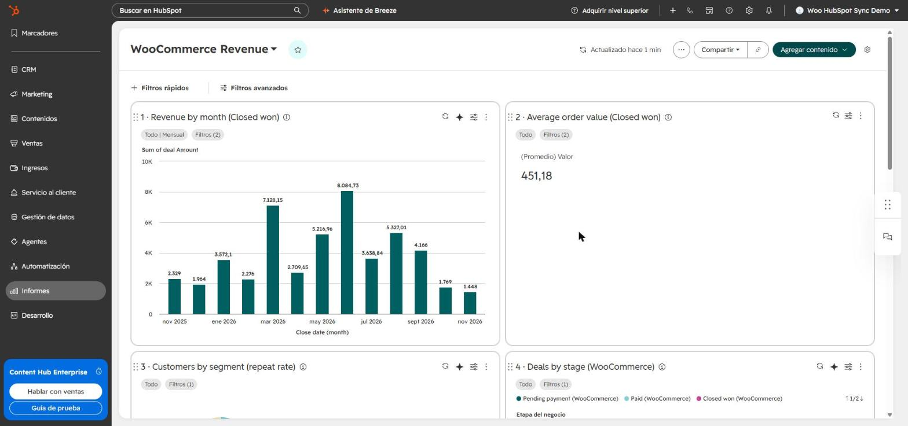
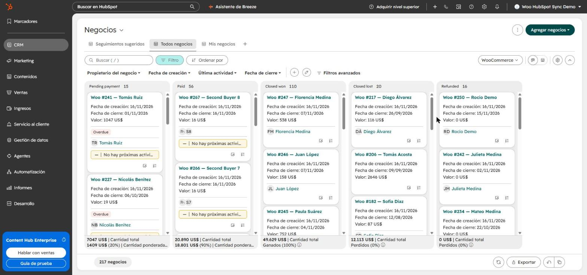
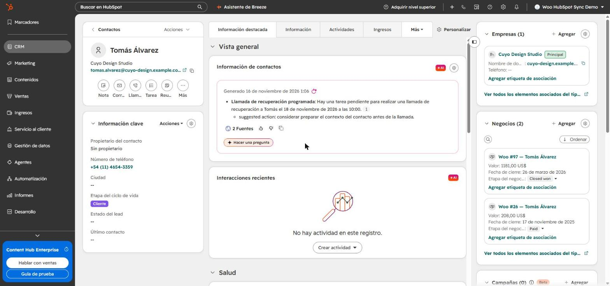
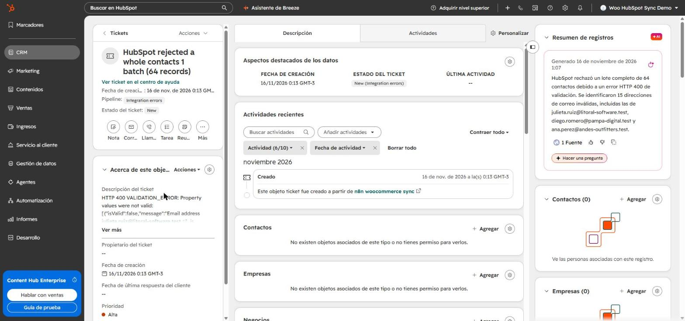
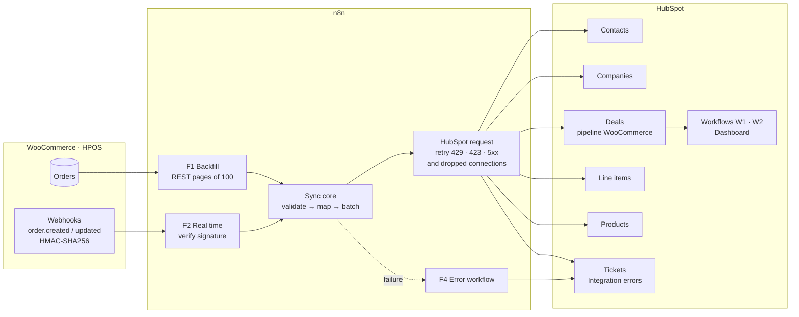

# WooCommerce → HubSpot sync (n8n)

A sync a sales team can trust: WooCommerce customers, orders and products land in HubSpot as contacts,
companies, deals and line items, **exactly once**, with refunds reflected, bad data quarantined, and
retries that never create duplicates. Built with n8n and the HubSpot CRM API; runs locally with one
`docker compose up`.

> Demo project. All data is generated (seed 42): fictional names, company domains are subdomains of the
> IANA-reserved `example.com`, no real customers. HubSpot side runs in a free developer test account.

## Result against a real HubSpot account (2026-11-16)

`node scripts/verify-hubspot.mjs` after the backfill, two real-time bursts and the workflows:

| Check | Result |
|---|---|
| Woo orders → HubSpot deals | **217 → 217**, 0 duplicate `woo_order_id` |
| Duplicate companies / products / line items | **0 / 0 / 0** (re-runs and bursts of concurrent webhooks included) |
| Contacts · companies | 128 synced contacts (+2 HubSpot sample contacts) · 9 companies, one per business domain |
| Caught by validation | 9 contacts flagged *Needs review* (bad phone/country) + 9 orders whose email was unusable → tickets |
| Closed won | 110 deals · **49,629.44 USD** · average order 451.18 USD (same numbers in the HubSpot dashboard) |
| Workflow W1 | 67 contacts → Customer · New 39 / Repeat 12 / VIP 16 · 0 segments contradicting the synced totals |
| Workflow W2 | 39 customers with no purchase in 90 days → *At risk* + win-back task |

| Dashboard | Pipeline |
|---|---|
|  |  |
| **Contact (VIP, at risk)** | **A sync error, explained** |
|  |  |

## Why not the official app?

The free "HubSpot for WooCommerce" plugin covers the basics. This project targets what it does not do,
or charges for:

| Real problem | Native app | This sync |
|---|---|---|
| Modern Woo stores use **HPOS** order tables | Paid add-on | Reads orders through the Woo REST API → HPOS-independent |
| HubSpot does **not dedupe companies created via API** | — | Upserts companies by a unique `woo_company_domain` |
| Retries that **duplicate deals** | Not documented | Upserts by unique `woo_order_id` (idempotent) |
| **Refunds and cancellations** | Not documented | Deal stage and amount follow the refund |
| **Dirty data** (typo emails, phones, countries) | No | Validation + "Needs review" list + error tickets |
| Own business rules (repeat buyer, VIP) | Limited | HubSpot workflows on synced totals |

## How it works



Per batch of ≤100 orders the sync core writes, in order: contacts (upsert by email, with order totals) →
companies (upsert by unique domain key) → products (search, then update or create) → deals (upsert) →
line items (upsert) → associations → error tickets. About 10 HubSpot requests per 100 orders, far under the 100 requests / 10 s limit.

## Data mapping

| WooCommerce | HubSpot | Idempotency key |
|---|---|---|
| Billing customer | Contact | `email` |
| Billing company / email domain (not gmail, hotmail…) | Company | `woo_company_domain` (unique) |
| Product | Product | `woo_product_id` (searched first — HubSpot products can't have unique properties) |
| Order | Deal in pipeline **WooCommerce** | `woo_order_id` (unique) |
| Order item | Line item (linked to product and deal) | `woo_line_item_key` (unique) |
| Sync problem | Ticket in pipeline **Integration errors** | `sync_error_key` (unique) |

| Woo status | Deal stage |
|---|---|
| pending, on-hold | Pending payment |
| processing | Paid |
| completed | Closed won (amount net of partial refunds) |
| cancelled, failed | Closed lost |
| refunded | Refunded (amount 0, `refund_amount` = refunded total) |

Contact properties written by the sync: `total_orders`, `woo_total_revenue` (paid orders, net of refunds; HubSpot's own `total_revenue` is read-only),
`first_order_date`, `last_order_date`, `woo_customer_id`, `data_quality_status`, `data_quality_issues`.
`customer_segment` (new / repeat / VIP) is set by HubSpot workflow W1 — see
[docs/hubspot-config.md](docs/hubspot-config.md) for W1, W2, the list and the dashboard.

## Decisions

| Decision | Why |
|---|---|
| All HubSpot calls via HTTP Request + batch endpoints, not n8n's HubSpot node | The node has no line items, products or associations, and works one record at a time |
| Totals computed from Woo, not HubSpot rollups | Woo is the source of truth for refunds; rollup support varies by tier |
| One "HubSpot request" sub-workflow for every call | One place for auth, retries and backoff (429 waits out the 10 s window, 423 ≥ 2 s, honors `Retry-After`) |
| A rejected batch (4xx) becomes a ticket, not a crash | HubSpot rejects the whole batch for one bad record; the other objects of the chunk still sync |
| Real-time flow re-reads the order from Woo | Webhooks can arrive late or out of order; the synced state is always the current one |
| Bad fields are dropped, never block the sync | A typo in a phone must not hide a $500 order from sales |
| Orders with an unusable email still sync (deal without contact) + ticket | Revenue stays right; someone gets a task to fix the email |
| Logic in `src/lib` (plain JS, unit-tested), inlined into Code nodes at build time | What runs in n8n is exactly what the tests cover |
| Service Key auth | HubSpot stopped allowing new private apps on 2026-10-26 |

## Run it

Requirements: Docker, Node 22+. No npm dependencies.

```bash
cp .env.example .env            # set WP_ADMIN_PASSWORD; HUBSPOT_SERVICE_KEY when you have one
docker compose up -d
bash scripts/setup-woo.sh        # WordPress + WooCommerce (HPOS), catalog, app password, webhooks
node scripts/generate-orders.mjs --seed 42 --count 200
docker compose run --rm wpcli wp eval-file /cli/load-orders.php   # ~5 min, re-runnable
node scripts/hubspot-setup.mjs   # properties + pipelines in HubSpot (idempotent)
node scripts/n8n-credentials.mjs # n8n credentials from .env (nothing printed)
bash scripts/n8n-import.sh       # build, import and publish the workflows
bash scripts/run-backfill.sh     # F1; F2 then runs on every order change
node scripts/verify-hubspot.mjs  # counts, duplicates, revenue — exit 1 on mismatch
```

No HubSpot account yet? `docker compose --profile mock up -d hubspot-mock` starts an in-memory stand-in
(`scripts/hubspot-mock.mjs`); start n8n with `HUBSPOT_BASE_URL=http://hubspot-mock:4010` and verify with
`VERIFY_HUBSPOT_URL=http://localhost:4010`. It also injects 429/5xx on demand (`POST /__fail`).

Tests: `npm test` (node:test, 93 tests: validation, mapping, sync plan, webhook signature, retry policy,
generator, mock, build).

## What went wrong (and the fix)

Everything below was found by running the sync, not by reading docs. Full log: [docs/incidents.md](docs/incidents.md).

1. **First real run: 0 of 111 contacts synced.** HubSpot rejects `.test` emails as invalid, and one bad
   value fails the whole batch of 100. The sync kept going (deals and line items went in) and turned each
   rejected batch into a ticket that named the records and quoted HubSpot's message — the cause was clear in
   a minute. Fix: company emails on `example.com` subdomains; the sync now also rejects email shapes HubSpot
   refuses before sending them.
2. **HubSpot's own `total_revenue` contact property is read-only.** Writing it would have failed every
   contact batch. Fix: `woo_total_revenue`, and the setup script now refuses any name HubSpot already owns.
3. **Duplicates under concurrency.** Search-then-create looked fine in tests, but 43 webhooks at once created
   4 duplicate companies, and `order.created` + `order.updated` for the same new order duplicated its line
   items. `verify-hubspot.mjs` caught both. Fix: companies and line items accept unique properties (checked
   with a throwaway property), so both are now upserted by unique keys and HubSpot enforces "one". Products
   can't have unique properties, so they keep search-then-write (catalog changes are rare).
4. **"The connection was aborted"** during that burst: a network error with no HTTP status, so the 429/5xx
   retry never saw it. Fix: HTTP nodes also retry dropped connections.
5. **WooCommerce silently dropped webhooks** to the integration: it blocks private hosts *and* ports other
   than 80/443/8080. Fix: a 20-line must-use plugin allows exactly that host and port.
6. **Products cannot have unique properties in HubSpot** — caught by an independent code review before the
   first real run; the planned product upsert would have failed every sync.

## Limits

- Runs against a HubSpot **developer test account**: it expires after 90 days without API calls
  (renewable). Workflows/reports need a Pro/Enterprise hub; the test account's trial provides them.
- Service Keys do not receive HubSpot webhooks; this sync does not need them (events come from Woo).
- Products are the one object HubSpot won't key uniquely, so a product first sold in two simultaneous
  webhooks could still be created twice (search index lag). `verify-hubspot.mjs` reports it if it happens.
- Report 5 (top products) is generated by HubSpot's report AI and lists the top 10 alphabetically, not by
  revenue; sort it in the report editor if you rebuild it.
- The backfill holds all orders in memory to compute customer totals — fine for thousands of orders,
  not for millions (that would need a customer-level pass first).
- Local demo only: n8n exposes the webhook secret to workflows via `$env`, HTTP without TLS.

## Stack

WooCommerce REST API & webhooks · n8n 2.47 · HubSpot CRM API (objects v3, associations v4) ·
HubSpot workflows & reports · Docker Compose · Node 24 (`node:test`).

MIT license.
